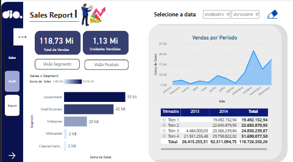
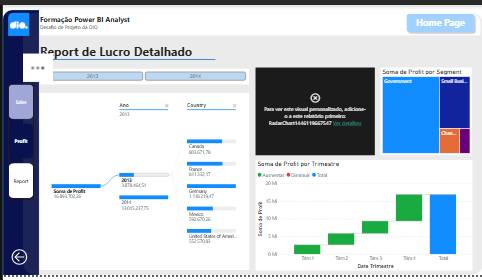
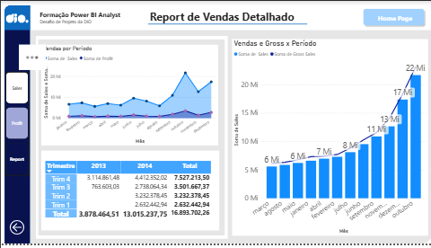

# Relatório de Vendas e Lucros com Power BI

Projeto do desafio **Criando um Relatório Vendas e Lucros com Data Analytics com Power BI**, da formação Power BI Analyst da DIO.

## Objetivo

Evoluir o relatório criativo fornecido na aula, com foco em experiência do usuário e navegação entre as páginas.

## O que foi feito

- Menu de navegação lateral em todas as páginas (Sales, Profit e Report), com o mesmo posicionamento.
- Estados dos botões do menu configurados: padrão, ao focalizar e selecionado, com o botão da página atual em azul escuro e texto branco.
- Barra lateral e logo da página Profit padronizados com os da página Sales, ajustando o espaçamento para o menu caber dentro da barra.
- Remoção do elemento decorativo que não cabia no layout da página Profit.

## Páginas

| Página | Imagem |
|---|---|
| Sales |  |
| Profit |  |
| Report |  |

## Arquivos

- `Relatorio_Vendas_Lucros_UX.pbix`: relatório final em Power BI Desktop.
- `01_sales.png`, `02_profit.png`, `03_report.png`: capturas das três páginas.

## Fonte dos dados

Tabela `financials`, do relatório-base fornecido pela DIO.
